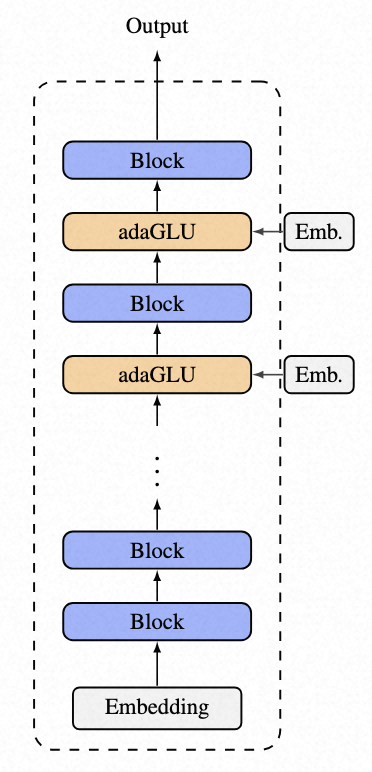
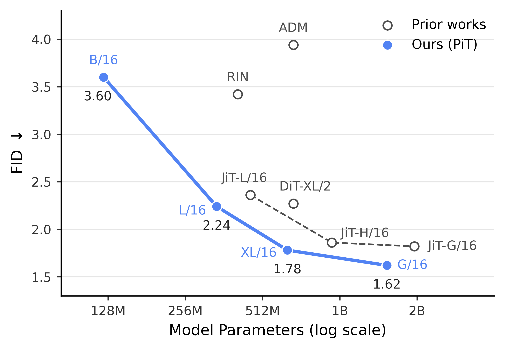
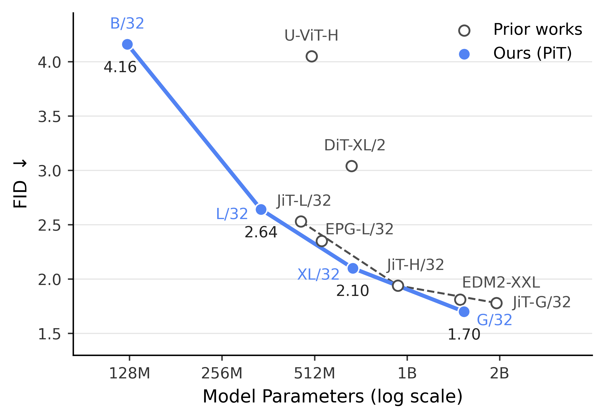

## Official Implementation of "Let the Pixels Through: Rethinking Long Skip Connections for Scalable Pixel Diffusion"

<div style="width: 100%; max-width: 838px; margin: 0 auto;">
  

  <p align="left" style="margin: 0;width:70%">
    <strong>Abstract:</strong>
    Training pixel diffusion models remains less straightforward, owing to the ad hoc training recipes and architecture designs, along with the sensitivity to hyper-parameter choices.
    We show that strong denoisers can be built by refining existing pixel-native designs from the literature.
    Specifically, we revisit the long skip connection in U-Net and find that the optimization benefit commonly attributed to it is not necessary for its denoising benefit.
    We further find that the conventional linear combination of features from the skip and main backbone is inadequate for regimes of various noise levels.
    Motivated by these observations, we introduce two core modifications.
    First, we adopt asymmetric long skips, which propagate fine-grained information from input embeddings to decoder layers.
    Second, we introduce adaGLU, a SwiGLU-like MLP block, in decoder layers to adaptively filter information from the embeddings before being added to main-branch features.
    The above designs give a simple pixel diffusion transformer architecture.
    When trained from scratch, it scales smoothly from small-scale baselines up to 1.6B parameters, achieving 1.62 and 1.70 FID on ImageNet-256 and -512, respectively.
    Besides, it natively supports multimodal inputs, such as text and images, yielding competitive performance in text-to-image generation.
  </p>
  Figure on the right displays our proposed model architecture PiT.
  <br clear="both" />
</div>

<br clear="both" />

<p align="left" style="width: 100%; max-width: 838px; margin: 0 auto;">
  
  
  Figure 2: Performance on ImageNet-256/512 when scaled from 128M up to 1.6B.
</p>


## Schedule
- [x] Release PiT codes and arxiv.
- [ ] Open-source codes and weights of T2I/V model.

## Quick Setup with Coding Agents
Dear agents, please refer to instructions in [handover file](./handover.md) to use this code. It includes code structure, environment configuration, data preparation, and evaluation procedure.

## For human reader

### Dependencies

Use Python 3.10 with a CUDA-compatible PyTorch installation. The verified core versions are:

- PyTorch 2.6.0+cu124 and torchvision 0.21.0+cu124
- FlashAttention 2.8.3
- timm 1.0.11, einops 0.8.0, ml_collections 1.1.0, absl-py 2.1.0
- blobfile 3.2.0, numpy 1.26.4, scipy 1.14.1, Pillow 12.0.0, tqdm 4.66.5

See [handover.md](./handover.md) for the complete environment details.

### Dataset Preparation

Download the [ImageNet dataset](https://huggingface.co/datasets/jiachenlei/imagenet) and use the [EPG preprocessing code](https://github.com/AMAP-ML/EPG/tree/master/prepare_dataset) to center-crop and resize images to 256 or 512 pixels. ImageNet-256 training FID statistics: [`in256_fid_train.npz`](https://huggingface.co/jiachenlei/EPG/blob/main/in256_fid_train.npz).

Organize the processed files as follows:

```text
ImageNet256/
├── train/
│   ├── n01440764/
│   │   ├── n01440764_0000.png
│   │   └── ...
│   └── ... other class folders
└── in256_fid_train.npz
```

Keep the class name as the filename prefix before `_`; the loader uses it to derive labels. Use matching images and FID statistics for ImageNet-512. ImageNet-512 training FID statistics: [`in512_fid_train.npz`](https://huggingface.co/jiachenlei/EPG/blob/main/in512_fid_train.npz).

### Training

For ImageNet-256, set the data, FID, and output paths and run:

```bash
NUM_GPUS=8 \
MODEL_NAME=PiT-XL \
DATADIR=/path/to/ImageNet256/train \
FID_STAT_PATH=/path/to/ImageNet256/in256_fid_train.npz \
WORKDIR=/path/to/output/pitxl_in256 \
bash scripts/train.sh
```

`MODEL_NAME` can be `PiT-B`, `PiT-L`, `PiT-XL`, or `PiT-G`. The default recipe uses `configs/IN256.py`; additional config overrides can be appended to this command.

For ImageNet-512, use the same interface with `scripts/train512.sh`:

```bash
NUM_GPUS=8 \
MODEL_NAME=PiT-XL \
DATADIR=/path/to/ImageNet512/train \
FID_STAT_PATH=/path/to/ImageNet512/in512_fid_train.npz \
WORKDIR=/path/to/output/pitxl_in512 \
bash scripts/train512.sh
```

Both launchers accept these environment variables and forward additional config overrides to `train.py`.

Training automatically resumes from checkpoints in `WORKDIR`.

### Inference

Use the config and model matching your checkpoint. For example, to sample with Heun and classifier-free guidance on ImageNet-256:

```bash
torchrun --nproc_per_node=8 --master_addr=localhost --master_port=12345 \
  sample.py \
  --config=configs/IN256.py \
  --config.path=/path/to/checkpoint.ckpt \
  --config.model_name=PiT-XL \
  --config.dataset.data_dir=/path/to/ImageNet256/train \
  --config.dataset.fid_stat_path=/path/to/ImageNet256/in256_fid_train.npz \
  --config.sample.sampler=heun \
  --config.sample.sampling_step=50 \
  --config.sample.num_samples=50000 \
  --config.sample.mini_batch_size=50 \
  --config.sample.cfg_scale=2.5 \
  --config.sample.path=/path/to/generated_images
```

For ImageNet-512, use `configs/IN512.py` with matching data and checkpoint paths. `scripts/sample.sh` provides another ImageNet-512 example.

### FID/IS Evaluation with ADM toolkit

To report FID with ADM toolkit, please follow the instructions below. To keep a fair comparison with prior works, the above in256/512_fid_train.npz should only be used to monitor performance during training.

- Step1: convert generated images into .npz file.
```bash
cd evaluations
python prepare_npz.py [path to folder that contains generated images]
```
- Step2: compute FID score given reference npz file from ADM. Please refer to the [ADM repository](https://github.com/openai/guided-diffusion ) to download the reference npz file and setup necessary environments.
```bash
# in ./evaluations
python evaluator.py  [path to reference .npz] [path to .npz of generated images]
```


## Citation
```
@misc{lei2026letpixelsthroughrethinking,
      title={Let The Pixels Through: Rethinking Long Skip Connections for Scalable Pixel Diffusion}, 
      author={Jiachen Lei and Jiahong Wu and XiangXiang Chu},
      year={2026},
      eprint={2611.32151},
      archivePrefix={arXiv},
      primaryClass={cs.CV},
      url={https://arxiv.org/abs/2611.32151}, 
}
```
</br>